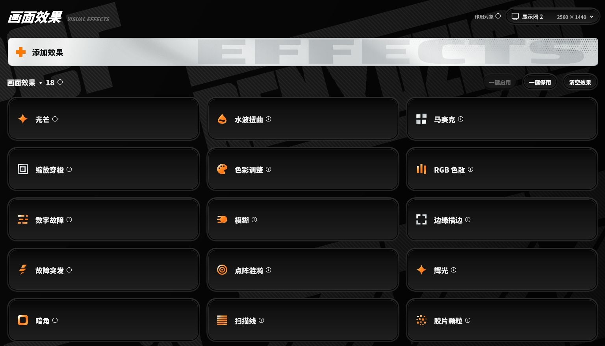
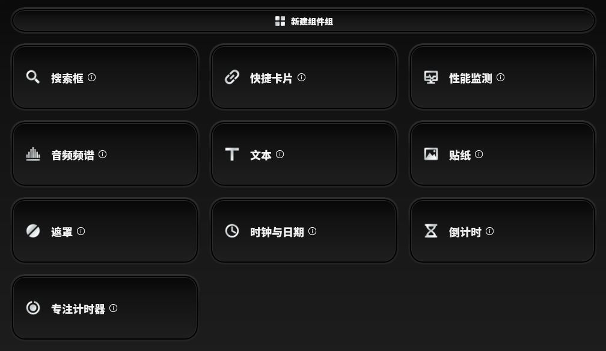

# ZZZwallpaper

[简体中文](README.md) · **English**

ZZZwallpaper lets you play a different image or video on each Windows display, make visual effects respond to music, and place clocks, audio visualizers, and shortcuts on your desktop. Save your wallpapers, effects, and widget layout together as a preset.

The interface supports English and Simplified Chinese. To switch languages, open **Settings → General → Display language** and restart the app.

## Test configuration

| Operating system | Processor | Memory | Graphics |
| --- | --- | --- | --- |
| Windows 11 Pro 25H2 x64 (26200.9711) | AMD Ryzen 9 9950X3D | 96 GB | NVIDIA GeForce RTX 5080 and integrated AMD Radeon Graphics |

## Set up your first wallpaper

1. Open **Library → Add media** and choose a local image or video. Use **Add folder** for a wallpaper collection. **Import from Wallpaper Engine** can import image and video projects from your local library. For scene and web projects, select the supported media files inside the project.
2. Choose a display in the upper-right corner. Select a wallpaper in the library and click **Apply selected media**. To rotate through several wallpapers, open **Home → Play queue** and choose **Loop one**, **Play in order**, or **Shuffle**. Each display has its own volume, position, and scale controls.
3. Open **Effects** to adjust the picture and **Widgets** to arrange your desktop tools. When you like the result, choose **Presets → Save current configuration** and give it a name.

## Visual effects and audio response

Use **Target** in the upper-right corner of **Effects** to choose where an edit applies. Target a display to give every wallpaper on it the same look. Target a particular image or video to keep its color adjustments when it comes up in the queue.



Click an effect card to edit its settings, or drag it to change the processing order. For example, placing **Blur** before **Particles** softens the background and leaves particles sharp. Move **Blur** after **Particles** and the particles soften too. [See both orders applied to the same frame](docs/diagrams/effect-order-comparison.png)

An audio rule can use the full spectrum, bass, midrange, or treble. Choose **Continuous** to vary an effect with the sound level, or **On beat** to trigger a glitch on a drum hit. A mask limits the effect to a selected area.

## Desktop widgets

Open **Widgets → Add widget** to choose a desktop tool. Add a clock, countdown, or focus timer to keep track of time. Use the audio spectrum to see what’s playing or the performance monitor to watch system activity. A shortcut can open a website, program, or folder. Search boxes, text, stickers, and masks are also available.



Align widgets with the edges of a display or with another widget on that display. Create a group to position several widgets together. You can lock their positions to prevent accidental dragging and separately control whether they respond to clicks.

## Presets, extensions, and automation

- **Presets** let you choose what to save from **Playing**, **Library**, **Effects**, and **Widgets**. To share only a desktop layout, select **Widgets**. Exporting to ZIP includes the media files the selected configuration needs. On import, you can map the preset to your displays. **Include private content** controls whether private widget details, such as shortcut targets, are included.
- **Extensions** add effects, widgets, and media. Import a publisher-signed ZIP under **Settings → Extensions**. This repository contains the app and its base pack. Import the separate optional pack to add the warehouse widget (搜索物资) and seven additional particle styles. [Extension pack format and import instructions (Chinese)](docs/功能扩展包.md)
- **Model Context Protocol (MCP)** lets compatible clients check what’s playing, switch playlists, adjust effects, and manage widgets. MCP is off by default. To connect a client, enable MCP in Settings and copy the connection configuration shown by the app. [MCP guide (Chinese)](docs/MCP使用说明.md)

## Build from source

<details>
<summary>Windows x64 build instructions</summary>

Install PowerShell 7, the .NET 8 SDK, Visual Studio 2022 C++ Build Tools, and the Windows SDK. From the repository root, run the following commands.

```powershell
.\scripts\Get-Dependencies.ps1
.\scripts\Get-InstallerBuildTools.ps1
foreach ($app in 'ControlCenter', 'WidgetHost', 'BaseWidgets', 'McpBridge') {
    dotnet restore "src/Windows/$app/$app.csproj" --locked-mode
    if ($LASTEXITCODE -ne 0) { throw "Restore failed for $app" }
}
dotnet restore src/Windows/InstallerPreview/InstallerPreview.csproj --locked-mode -p:PublishSingleFile=true
if ($LASTEXITCODE -ne 0) { throw "Installer dependency restore failed" }
.\scripts\Build-Modular.ps1
```

The build writes its output to `artifacts/windows-x64-<timestamp>/`. Keep the directory together and run `ZZZwallpaper.Launcher.exe` from it. To build a Windows installer, run `scripts/Build-Installer.ps1`.

The dependency script verifies FFmpeg, the taskbar component, and its corresponding source archives by SHA-256. FFmpeg is pinned to the build dependency asset on the v1.0.0 release. While the release is a draft, sign in with a GitHub CLI account that has access to the draft, or place the original ZIP with the pinned checksum in `third_party/` before running the script. [FFmpeg dependency lock](scripts/ffmpeg.lock.json) · [Taskbar dependency manifest](third_party/translucenttb/files.json) · [Application source](src/)

</details>

## License

The original program code is licensed under **AGPL-3.0-only**. Third-party libraries, fonts, and media are covered by their respective terms. [License](LICENSE) · [Scope](NOTICE.md) · [Third-party notices](docs/THIRD-PARTY-NOTICES.md) · [Source distribution](docs/SOURCE-DISTRIBUTION.md)
