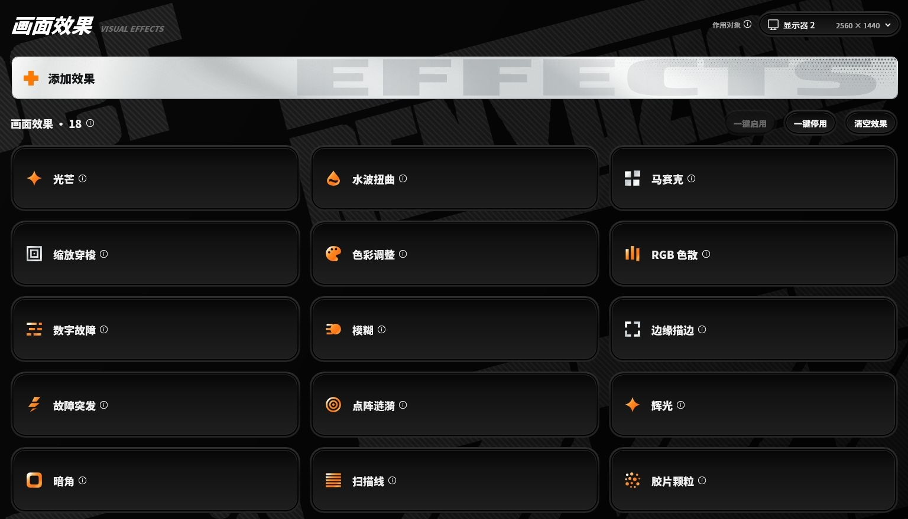
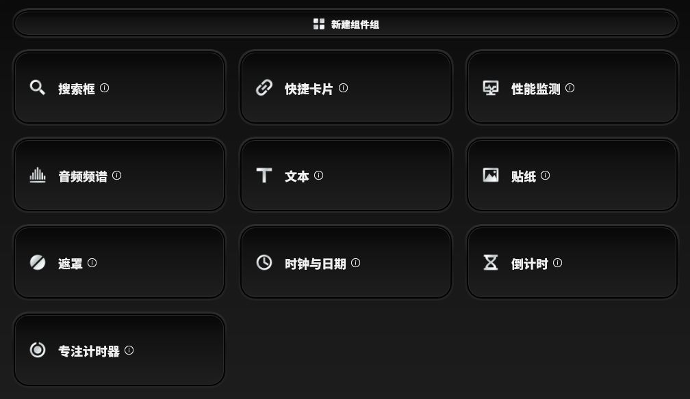

# ZZZwallpaper

**简体中文** · [English](README.en.md)

ZZZwallpaper 是一款 Windows x64 桌面壁纸与组件软件。你可以让两块显示器播放不同的壁纸，让画面随音乐节拍变化，再把时钟、频谱或快捷卡片摆到桌面上。壁纸、效果和组件布局可以一起保存成预设。

界面支持简体中文和 English，可在「设置 → 通用 → 界面语言」切换。

## 测试配置

| 系统 | 处理器 | 内存 | 显卡 |
| --- | --- | --- | --- |
| Windows 11 专业版 25H2 x64（26200.9711） | AMD Ryzen 9 9950X3D | 96 GB | NVIDIA GeForce RTX 5080、AMD Radeon Graphics（集成） |

## 从一张壁纸开始

1. 打开「素材库」，点击「添加素材」选择本地图片或视频。已有一整个壁纸目录，可以直接选「添加文件夹」。使用 Wallpaper Engine 本地库时，图片和视频项目可直接导入，场景和网页项目可以挑选其中支持的媒体素材。
2. 在窗口右上角选好目标显示器，在素材库选中壁纸并点击「应用所选素材」。想轮换播放时，在「首页」打开「播放队列」编排列表，选择单个循环、顺序轮播或随机轮播。每块屏幕可以分别调整壁纸音量、位置和缩放。
3. 在「画面效果」添加喜欢的效果，在「组件」摆好桌面工具。完成后打开「预设 → 保存当前配置」，给这套桌面起个名字。

## 画面效果与音频联动

「画面效果」右上角的「作用对象」决定修改范围。给显示器添加效果，适合统一整块屏幕的观感；给某一张图片或某一段视频单独调色，可以让它在轮播时保留自己的效果。



点击卡片可以调参数，按住拖动可以改变处理顺序。例如，把「模糊」放在「粒子」前面，背景变柔而粒子保持清晰；移到「粒子」后面，粒子也会一起模糊。[查看同一画面在不同顺序下的渲染对比](docs/diagrams/effect-order-comparison.png)

音频联动可以选整体声音、低频、中频或高频作为输入。想让画面随着音量逐渐变化，可以选「连续跟随」；想让故障效果随鼓点出现，可以选「节拍触发」。蒙版可限定效果出现的区域。

## 桌面组件

在「组件 → 添加组件」里选择要放到桌面上的工具。时钟与日期、倒计时和专注计时器适合常驻显示；音频频谱和性能监测可以显示实时变化；快捷卡片可以打开常用网址、程序或文件夹。也可以添加搜索框、文本、贴纸和遮罩。



同屏组件可以互相对齐，也可以对齐到显示器。多个组件放进一组后可以一起定位。摆好后锁定位置，能防止误拖；是否响应点击可以单独设置。

## 保存、分享与扩展

- **预设**可以分别保存「正在播放」「素材库」「画面效果」「组件」。例如，只想分享桌面布局时，可以单独勾选「组件」。导出 ZIP 时会带上所选配置需要的媒体资源，导入后可指定目标显示器。快捷卡片等组件的私人内容由「包含隐私内容」选项控制。
- **扩展包**可以增加新的画面效果、组件和素材。在「设置 → 扩展包」导入带发布者签名的 ZIP。此仓库只包含基础程序和基础包。导入独立扩展包后才会出现「搜索物资」组件和七种额外的粒子外观。[扩展包格式与导入说明](docs/功能扩展包.md)
- **MCP 自动化**允许兼容的客户端查询当前播放状态、切换播放列表、调整效果和管理组件。MCP 默认关闭，需要时在设置中开启，并复制软件显示的连接配置。[MCP 使用说明](docs/MCP使用说明.md)

## 从源码构建

<details>
<summary>展开 Windows x64 构建步骤</summary>

准备 PowerShell 7、.NET 8 SDK、Visual Studio 2022 C++ Build Tools 和 Windows SDK。在仓库根目录运行：

```powershell
.\scripts\Get-Dependencies.ps1
.\scripts\Get-InstallerBuildTools.ps1
foreach ($app in 'ControlCenter', 'WidgetHost', 'BaseWidgets', 'McpBridge') {
    dotnet restore "src/Windows/$app/$app.csproj" --locked-mode
    if ($LASTEXITCODE -ne 0) { throw "Restore failed for $app" }
}
dotnet restore src/Windows/InstallerPreview/InstallerPreview.csproj --locked-mode -p:PublishSingleFile=true
if ($LASTEXITCODE -ne 0) { throw "Installer dependency restore failed" }
.\scripts\Build-Modular.ps1
```

构建结果位于 `artifacts/windows-x64-<时间戳>/`。保留完整目录并运行其中的 `ZZZwallpaper.Launcher.exe`。构建 Windows 安装包使用 `scripts/Build-Installer.ps1`。

依赖脚本按 SHA-256 校验 FFmpeg、任务栏组件及其配套源码。FFmpeg 固定使用 v1.0.0 Release 的构建依赖附件。草稿阶段可通过有权访问草稿的 GitHub CLI 账号还原，或将相同 SHA-256 的原始 ZIP 放入 `third_party/` 后运行脚本。[FFmpeg 依赖锁定文件](scripts/ffmpeg.lock.json) · [任务栏依赖清单](third_party/translucenttb/files.json) · [程序源码](src/)

</details>

## 许可

原创程序代码采用 **AGPL-3.0-only**。第三方库、字体和媒体素材各自适用相应许可。[许可证原文](LICENSE) · [许可范围](NOTICE.md) · [第三方声明](docs/THIRD-PARTY-NOTICES.md) · [源码交付说明](docs/SOURCE-DISTRIBUTION.md)
